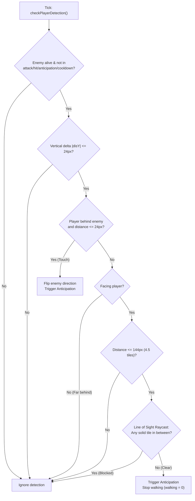

# Enemy Player Detection AI System

## Overview
This document details the player detection and vision system for enemies (`Pink Star`, `Crabby`, `Fierce Tooth`) in *Blade Voyage*, implemented in `src/client/entities/Enemy.ts`.

---

## 1. Core Detection Parameters

All values are scaled to the $32\text{px}$ tile grid and $640 \times 340$ viewport:

| Constant | Value | Physical Distance | Design Purpose |
|---|---|---|---|
| `ENEMY_SIGHT_RANGE_X` | `4.5 * 32` | $144\text{px}$ ($4.5$ tiles) | Tuned engagement range. Allows the player to see enemies before entering their aggro radius, giving control over when to engage without off-screen blindside triggers. |
| `ENEMY_SIGHT_RANGE_Y` | `24` | $24\text{px}$ ($0.75$ tile) | Tolerates player jumps and slight elevation changes without causing enemies on different vertical platforms/ledges to aggro. |
| `ENEMY_BEHIND_TOUCH_DIST` | `24` | $24\text{px}$ ($0.75$ tile) | Melee touch awareness. If the player physically bumps into an enemy from behind, the enemy notices and turns around. |
| `ENEMY_POST_ATTACK_COOLDOWN` | `90` | $90\text{ frames}$ ($1.5\text{s}$) | Post-attack recovery cooldown. Prevents continuous rapid-fire attacks and stunlock loops, giving the player an opening to punish, reposition, or escape. |

---

## 2. Detection Flow & Rules

Detection is evaluated on **every frame** during `Enemy.update(tilemap, movement, playerPos)` when `playerPos` is supplied:



---

## 3. Subsystems

### A. Continuous Every-Frame Awareness
- Detection runs continuously during both **idle** and **patrol** states.
- If the player enters an enemy's line of sight, the enemy instantly cancels its walk (`walking = 0`), halts in place, and enters the **Anticipation State**.

### B. Line-of-Sight (LOS) Raycasting
- Raycasts from the front edge of the enemy at eye level (`pos[1] + 16`) towards the player in $16\text{px}$ (half-tile) intervals:
```typescript
const enemyEyeY = this.pos[1] + 16;
const dir = this.flip ? -1 : 1;
const steps = Math.floor(absDistX / 16);
const startX = this.rect().x + (this.flip ? 0 : this.rect().width);

for (let i = 1; i < steps; i++) {
  const checkX = startX + dir * (i * 16);
  if (tilemap.solidCheck([checkX, enemyEyeY])) {
    return false; // Vision occluded by solid terrain
  }
}
```
- Solid tiles (`grass`, stone) fully occlude vision, preventing enemies from detecting players through cavern walls or closed corridors.

### C. Rear Touch Awareness vs. Stealth
- If the player is $> 24\text{px}$ behind an enemy, the enemy remains completely blind. This enables stealth gameplay: sneaking up from behind to throw swords or strike stealth attacks.
- If the player closes within $\le 24\text{px}$ behind the enemy (physical body overlap), the enemy senses the contact, flips direction, and alerts.

---

## 4. State Transitions Post-Detection

1. **Anticipation State (`anticipationState = true`)**:
   - Action switches to `'anticipation'`.
   - Exclamation dialogue bubble (`'dialogue/exclamation'`) appears above the enemy's head.
   - SFX plays on dialogue frame 1 (`12` ticks).
   - Telegraph duration: $3\text{ frames} \times 20\text{ duration} = 60\text{ ticks}$ ($1.0\text{s}$) across all enemy types (`Pink Star`, `Crabby`, `Fierce Tooth`). This consistent telegraph window gives the player ample time to jump, back up, or throw a sword.
2. **Attack State (`attackTimer > 0`)**:
   - Once anticipation completes (`animation.done`), automatically initiates `attack()`.
   - **Pink Star**: Charges forward at velocity $\pm 2$ for $120$ frames with grass sparks, bouncing off walls.
   - **Crabby**: Performs dual-claw melee attack (`attackTimer = 24`, active hit range $40\text{px}$ for frames $\ge 12$).
   - **Fierce Tooth**: Performs bite attack (`attackTimer = 30`, active hit range $26\text{px}$ for frames $\ge 15$).
3. **Post-Attack Recovery Cooldown (`attackCooldown`)**:
   - When an attack concludes (`attackTimer === 0`), `attackCooldown` is set to `90` frames ($1.5\text{s}$).
   - While in recovery, the enemy cannot re-trigger detection or attack, giving the player a generous punishment window to counter-attack or disengage.
