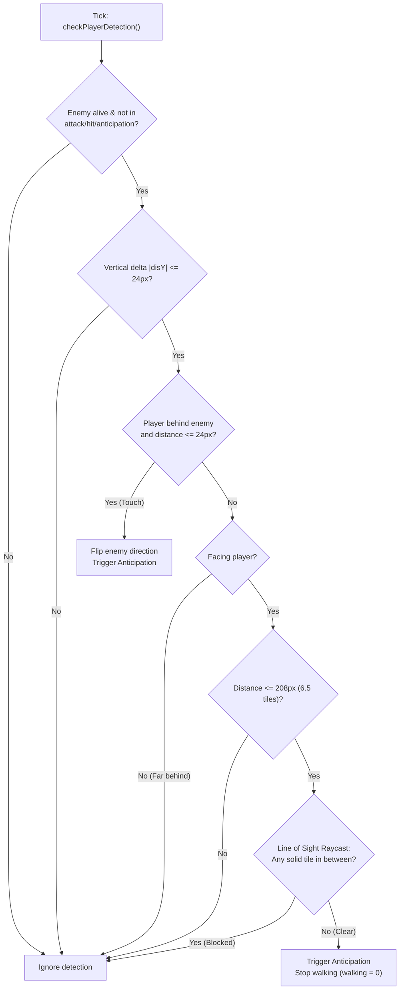

# Enemy Player Detection AI System

## Overview
This document details the player detection and vision system for enemies (`Pink Star`, `Crabby`, `Fierce Tooth`) in *Blade Voyage*, implemented in `src/client/entities/Enemy.ts`.

---

## 1. Core Detection Parameters

All values are scaled to the $32\text{px}$ tile grid and $640 \times 340$ viewport:

| Constant | Value | Physical Distance | Design Purpose |
|---|---|---|---|
| `ENEMY_SIGHT_RANGE_X` | `6.5 * 32` | $208\text{px}$ | ~65% of half-screen vision. Ensures enemies only spot the player when visible on screen, preventing off-screen blindside attacks. |
| `ENEMY_SIGHT_RANGE_Y` | `24` | $24\text{px}$ ($0.75$ tile) | Tolerates player jumps and slight elevation changes without causing enemies on different floors/ledges to aggro. |
| `ENEMY_BEHIND_TOUCH_DIST` | `24` | $24\text{px}$ ($0.75$ tile) | Melee touch awareness. If the player physically bumps into an enemy from behind, the enemy notices and turns around. |

---

## 2. Detection Flow & Rules

Detection is evaluated on **every frame** during `Enemy.update(tilemap, movement, playerPos)` when `playerPos` is supplied:



---

## 3. Subsystems

### A. Continuous Every-Frame Awareness
- Unlike the original Pygame source (which only checked on the single frame when a walking bout reached 0), detection runs continuously during both **idle** and **patrol** states.
- If the player runs into an enemy's line of sight, the enemy instantly cancels its walk (`walking = 0`), halts in place, and enters the **Anticipation State**.

### B. Line-of-Sight (LOS) Raycasting
- Raycasts from the front edge of the enemy at eye level (`pos[1] + 16`) towards the player in $16\text{px}$ (half-tile) intervals:
```typescript
const enemyEyeY = this.pos[1] + 16;
const dir = this.flip ? -1 : 1;
const steps = Math.floor(absDistX / 16);
const startX = this.rect().x + (this.flip ? 0 : this.rect().width);

for (let i = 1; i < steps; i++) {
  const checkX = startX + dir * (i * 16);
  if (tilemap.solidCheck([checkX, enemyEyeY])) {
    return false; // Vision occluded by solid terrain
  }
}
```
- Solid tiles (`grass`, stone) fully occlude vision, preventing enemies from detecting players through cavern walls.

### C. Rear Touch Awareness vs. Stealth
- If the player is $> 24\text{px}$ behind an enemy, the enemy remains completely blind. This enables sneaking up from behind to throw swords or strike stealth attacks.
- If the player closes within $\le 24\text{px}$ behind the enemy (physical body overlap), the enemy senses the contact, flips direction, and alerts.

---

## 4. State Transitions Post-Detection

1. **Anticipation State (`anticipationState = true`)**:
   - Action switches to `'anticipation'`.
   - Exclamation dialogue bubble (`'dialogue/exclamation'`) appears above enemy head.
   - SFX plays on dialogue frame 1 (`12` ticks).
   - Telegraphs attack for $60$ ticks ($1.0\text{s}$), giving the player time to react (dodge, throw sword, or parry).
2. **Attack State (`attackTimer > 0`)**:
   - Once anticipation completes (`animation.done`), automatically initiates `attack()`.
   - **Pink Star**: Charges forward at velocity $\pm 2$ for $120$ frames with grass sparks, bouncing off walls.

